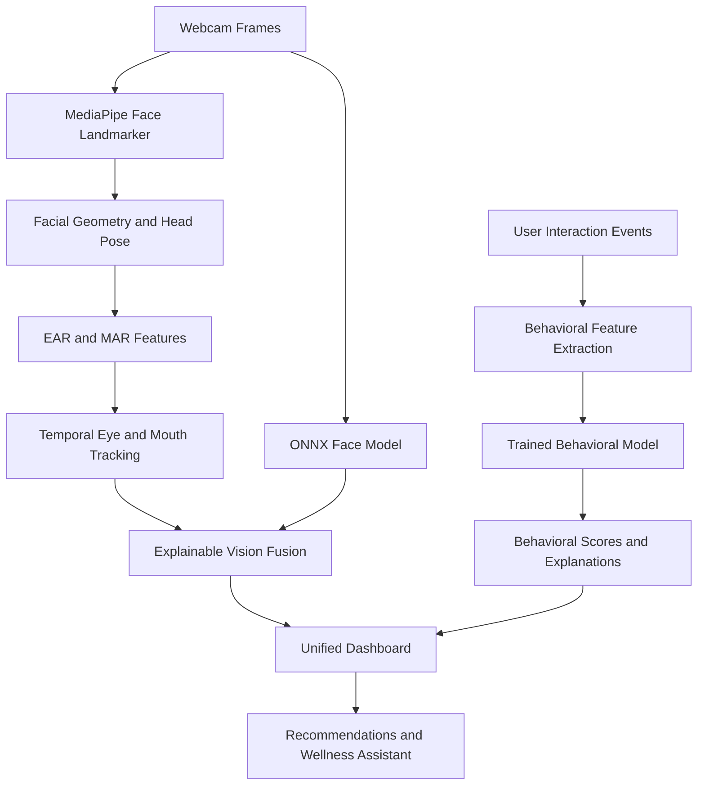

# NeuroPulse AI — Real-Time Fatigue Detection & Behavioral Intelligence

**NeuroPulse AI** is a multimodal fatigue-monitoring prototype that combines real-time computer vision with behavioral analytics to identify potential signs of drowsiness, fatigue, and changes in user interaction patterns.

The project brings together webcam-based facial analysis, temporal eye-state tracking, behavioral feature extraction, machine learning, explainable outputs, and a unified dashboard to explore how fatigue-related signals can be detected and interpreted in real time.

> **Disclaimer:** NeuroPulse AI is an experimental research prototype, not a medical diagnostic system. Its scores and predictions should not be used as a substitute for clinical assessment or as the sole basis for safety-critical decisions.

## Table of Contents

- [Overview](#overview)
- [Key Features](#key-features)
- [System Architecture](#system-architecture)
- [Vision-Based Fatigue Detection](#vision-based-fatigue-detection)
- [Behavioral Intelligence](#behavioral-intelligence)
- [Modeling and Explainability](#modeling-and-explainability)
- [Dashboard and Integration](#dashboard-and-integration)
- [Technology Stack](#technology-stack)
- [Project Structure](#project-structure)
- [Installation and Setup](#installation-and-setup)
- [Running NeuroPulse AI](#running-neuropulse-ai)
- [Training and Evaluation](#training-and-evaluation)
- [Testing](#testing)
- [Current Limitations](#current-limitations)
- [Future Scope](#future-scope)

---

## Overview

Fatigue does not always appear as an obvious sign of sleepiness. It can manifest through prolonged eye closure, changes in facial activity, altered interaction patterns, hesitation, and extended periods of inactivity.

NeuroPulse AI explores a multimodal approach to this problem by analyzing two complementary sources of information:

- **Vision intelligence:** Uses webcam frames, facial landmarks, eye-closure duration, mouth activity, and head-pose cues to estimate visual signs of fatigue.
- **Behavioral intelligence:** Analyzes interaction patterns such as typing variability, click hesitation, and idle activity to identify behavioral signals associated with possible fatigue or reduced engagement.

These signals are brought together through the project's scoring and dashboard components to provide interpretable feedback rather than relying exclusively on a single frame or isolated event.

## Key Features

- **Real-time webcam analysis** using MediaPipe facial landmarks and ONNX model inference.
- **Personalized eye calibration** to estimate an individual's open-eye baseline.
- **Temporal fatigue detection** that distinguishes ordinary blinks from sustained eye closure.
- **Mouth activity analysis** to distinguish brief speech-related opening from prolonged opening that may indicate a possible yawn.
- **Head-pose tracking** to provide additional context about downward head movement.
- **Behavioral analytics** for interaction patterns, including typing variability, click hesitation, and idle periods.
- **Machine learning-based behavioral scoring** using the project's trained classification or prediction pipeline.
- **Explainable outputs** with fatigue states, activity information, and human-readable decision reasons.
- **Unified dashboard** for exploring behavioral results and vision-related information.
- **Personalized recommendations and conversational support** through the recommendation and wellness-assistant components.
- **Automated tests** for validating important vision and integration behavior.

Feature availability depends on the corresponding model artifacts, configuration, and connected components.

## System Architecture

NeuroPulse AI is organized around two analysis pipelines with a shared presentation layer.



The vision pipeline focuses on facial and temporal evidence. The behavioral pipeline analyzes interaction-derived features. Their outputs are presented through the dashboard, with the degree of fusion depending on the active application configuration.

## Vision-Based Fatigue Detection

The vision subsystem has been developed and refined to make fatigue decisions more robust than simple frame-by-frame classification.

### 1. Facial landmark detection

The application uses the MediaPipe Face Landmarker Tasks API through the project's vision detection and geometry modules.

It extracts facial landmarks to calculate:

- Left-eye and right-eye aspect ratios.
- Combined Eye Aspect Ratio (EAR).
- Mouth Aspect Ratio (MAR).
- Head-pose information, including downward head movement.

The Face Landmarker model is stored at:

`models/mediapipe/face_landmarker.task`

### 2. Personalized eye calibration

Eye geometry varies across individuals, so the system does not assume that every person has the same open-eye EAR.

At startup, or when the user presses **C**, the application collects baseline samples while the user looks toward the camera.

The eye-state tracker uses hysteresis to reduce rapid switching between open and closed states:

- Closed-eye threshold: baseline EAR × 0.62.
- Open-eye threshold: baseline EAR × 0.80.

These are configurable implementation thresholds, not universal physiological constants.

### 3. Temporal eye-state tracking

The eye tracker evaluates closure duration over time rather than treating every frame as an independent prediction.

- Brief closures of up to 0.45 seconds are treated as blinks.
- Sustained closure of approximately 1.5 seconds can trigger a drowsiness event.
- When the user is looking downward, the configured sustained-closure threshold can increase to approximately 2.5 seconds.
- Missing landmarks or lost face tracking are represented as `UNKNOWN`, rather than automatically being interpreted as closed eyes.

This design helps reduce false alarms caused by ordinary blinking and temporary tracking failures.

### 4. Mouth activity and possible yawning

The mouth-state tracker uses temporal information to interpret mouth opening.

It distinguishes states such as:

- `closed`
- `speaking`
- `open`
- `candidate_yawn`

Short mouth openings can be classified as speech-related activity, while wider and sustained openings can be flagged as candidate yawns.

A possible yawn or mouth opening is supplementary evidence; it should not independently force the primary fatigue state to `DROWSY`.

### 5. ONNX face-model inference

The vision pipeline also supports face-model inference through ONNX Runtime.

The model processes a face crop using the configured preprocessing pipeline, including resizing to 160 × 160 and ImageNet normalization.

Its output is interpreted as a model score, with inference failures handled safely rather than silently converted into a confident prediction.

The face model acts as secondary evidence in the vision decision process. The temporal eye tracker remains responsible for determining eye state and sustained-closure events.

### 6. Explainable vision fusion

The vision fusion layer combines temporal eye evidence with supplementary facial cues.

The primary fatigue labels are:

- **`ALERT`** — sufficient evidence for a drowsiness event has not been established.
- **`DROWSY`** — the configured temporal decision rules have identified sufficient evidence for a drowsiness event.

Additional activity information, such as talking or glancing down, is kept separate from the primary fatigue label.

The system can produce human-readable reasons, such as `sustained_eye_closure_1.80s`, to make decisions easier to inspect and debug.

The displayed drowsiness index is a **heuristic score from 0–100**, not a calibrated probability of fatigue.

### Current eye-model design

The experimental eye-crop classifier was removed from the active runtime after testing did not demonstrate reliable assistance with eye-state decisions.

The active baseline relies on EAR and temporal eye tracking for open/closed eye-state decisions. Offline eye-crop training scripts or checkpoints, if retained in the repository, are research artifacts and are not part of the live decision pipeline.

For additional implementation details, see [`docs/VISION_MODEL.md`](docs/VISION_MODEL.md).

## Behavioral Intelligence

The behavioral subsystem complements webcam analysis by examining how a user interacts with a computer over time.

Depending on the active collector and available input events, behavioral features can include:

- **Typing variability:** Changes in typing cadence and intervals between keystrokes.
- **Click hesitation:** Changes in timing between mouse interactions.
- **Idle activity:** Periods with little or no detected interaction.
- **Interaction patterns:** Aggregated behavioral measurements used by the trained model.

The behavioral pipeline extracts features from interaction data and passes them to the project's trained machine learning model. Its outputs can then be used by the scoring and dashboard layers.

Behavioral features are indirect indicators. Typing speed, inactivity, and interaction delays can be affected by many factors unrelated to fatigue, so they should not be interpreted as definitive evidence of a person's mental or physical state.

Behavior collection should be transparent, limited to necessary signals, and conducted with appropriate user consent.

## Modeling and Explainability

NeuroPulse AI combines model inference with rule-based temporal analysis.

| Component | Purpose |
|---|---|
| MediaPipe Face Landmarker | Extracts facial landmarks |
| EAR-based temporal tracker | Tracks eye state, blinks, and sustained closure |
| MAR-based mouth tracker | Tracks mouth activity and possible yawning |
| ONNX face model | Supplies supplementary face-classification evidence |
| Behavioral ML model | Analyzes interaction-derived features |
| Vision fusion layer | Produces interpretable primary fatigue states |
| Dashboard and recommendation components | Present results and supporting guidance |

The project uses Python-based machine learning tools, including PyTorch and scikit-learn, with ONNX Runtime for supported inference paths.

Explainability is addressed through temporal decision reasons, separate activity labels, behavioral features, and dashboard-level interpretation. These mechanisms improve transparency, but they do not by themselves establish clinical validity or eliminate false positives.

## Dashboard and Integration

The Streamlit dashboard provides a presentation layer for the behavioral pipeline and the vision-mode integration.

It is intended to make model outputs and supporting information easier to inspect without requiring users to interpret raw model tensors or log files.

Depending on the active implementation, the dashboard can present:

- Behavioral analysis results.
- Vision-related fatigue information.
- Primary fatigue labels and supplementary activity.
- Scores and confidence-related information where available.
- Explanations and recommendation-oriented guidance.

The vision application's live overlay and JSON output also separate the primary fatigue label from optional activity information.

## Technology Stack

| Area | Technologies |
|---|---|
| Language | Python |
| Computer vision | OpenCV, MediaPipe |
| Deep learning | PyTorch, torchvision |
| Model inference | ONNX Runtime |
| Machine learning | scikit-learn |
| Numerical processing | NumPy |
| Dashboard | Streamlit |
| Explainability | Feature-based explanations and interpretable decision reasons |
| Testing | pytest and Python unittest |
| Version control | Git and GitHub |

Some packages are required only for training or exporting models; live inference may use a smaller subset.

## Project Structure

The following is a conceptual guide to the important project components. The exact files and optional artifacts may vary by branch.

```text
NeuroPulse-AI/
├── app.py
├── train.py
├── export_model_onnx.py
├── src/
│   ├── dashboard.py
│   └── personal_collector.py
├── vision/
│   ├── detector.py
│   ├── geometry.py
│   ├── eye_state.py
│   ├── mouth_state.py
│   ├── onnx_model.py
│   └── fusion.py
├── models/
│   └── mediapipe/
│       └── face_landmarker.task
├── data/
│   ├── train/
│   │   ├── drowsy/
│   │   └── notdrowsy/
│   └── val/
├── docs/
│   └── VISION_MODEL.md
├── tests/
├── datasets/
│   └── README.md
├── fatigue_model.onnx
├── fatigue_model.onnx.data
├── best_model.pth
├── training_history.json
└── README.md
```

Model files, datasets, and optional research scripts may not all be present in every checkout. Consult the actual repository and configuration before assuming a particular artifact is required.

## Installation and Setup

### Prerequisites

- Python compatible with the installed MediaPipe, PyTorch, and ONNX Runtime packages.
- Git.
- A working webcam for live vision analysis.
- The required model artifacts for the selected inference pipeline.

### 1. Clone the repository

```bash
git clone https://github.com/BhavanaBaalebail/NeuroPulse-AI.git
cd NeuroPulse-AI
```

If you are working from a collaborator's fork, use that repository's clone URL instead.

### 2. Create a virtual environment

macOS/Linux:

```bash
python3 -m venv .venv
source .venv/bin/activate
python -m pip install --upgrade pip
```

### 3. Install dependencies

Install the project's dependency file if one is provided:

```bash
pip install -r requirements.txt
```

If dependencies are maintained separately, install the packages required by the active application and model pipeline. Core components include:

```bash
pip install opencv-python numpy onnxruntime mediapipe
```

PyTorch and torchvision may also be needed for training and checkpoint export:

```bash
pip install torch torchvision
```

Install Streamlit and pytest if they are not already included in the project's dependencies:

```bash
pip install streamlit pytest
```

**Note:** Package versions and platform compatibility matter, particularly for MediaPipe and PyTorch. Use the repository's pinned dependency versions when available rather than blindly upgrading packages.

### 4. Verify model artifacts

Ensure the MediaPipe Face Landmarker model and the ONNX model expected by the selected application configuration are available at their configured paths.

If an ONNX model uses an external weights file, keep the `.onnx` and `.onnx.data` files together.

Do not assume that a `.pth` checkpoint is required at runtime if the active inference path uses ONNX Runtime.

## Running NeuroPulse AI

### Run the live vision application

From the project root:

```bash
python3 app.py
```

The live application initializes the camera and vision pipeline.

**Keyboard controls**

- `C` — Recalibrate the open-eye EAR baseline while looking at the camera.
- `Q` — Quit the application.

For the most meaningful calibration, maintain a natural, forward-facing gaze during the baseline collection.

### Run the Streamlit dashboard

From the project root, use the dashboard path supported by your checkout:

```bash
streamlit run src/dashboard.py
```

If your project expects the working directory to be `src/`, use:

```bash
cd src
streamlit run dashboard.py
```

Use the command appropriate to the actual file location and import configuration in your branch.

### Run the test suite

Using pytest:

```bash
pytest -v
```

Or, for tests written using Python's built-in unittest framework:

```bash
python3 -m unittest discover -s tests -v
```

## Training and Evaluation

The repository may contain separate scripts for dataset preparation, model evaluation, training, and ONNX export.

Run these only when the corresponding scripts and required datasets are present.

### 1. Prepare vision dataset splits

```bash
python3 prepare_vision_splits.py
```

Use source-grouped splits when the dataset contains multiple images from the same individual or capture session. This helps reduce the risk of data leakage between training and evaluation sets.

### 2. Evaluate the baseline model

```bash
python3 eval_grouped_resnet.py
```

Review the evaluation metrics and the split-generation process before comparing models.

### 3. Train vision models

```bash
python3 train_vision_models.py --epochs 8
```

The model options and training parameters depend on the implementation in the repository.

### 4. Export a trained checkpoint to ONNX

```bash
python3 export_vision_onnx.py \
  --checkpoint models/vision/best_resnet18.pth
```

Where supported, the export script should verify that the PyTorch and ONNX outputs agree numerically within the configured tolerance.

These commands are optional development workflows; they are not necessary for running an already configured inference pipeline.

## Testing

The project uses automated tests to check important decision and integration behavior.

Areas of interest include:

- Blink filtering versus sustained eye closure.
- Recovery to `ALERT` after the eyes reopen.
- Handling missing landmarks and face-tracking loss.
- Separating talking or downward head movement from the primary fatigue state.
- Safe behavior when model inference fails.
- Consistency of vision outputs and dashboard integration.

Run the test suite before merging changes to the temporal tracking, scoring, or model-integration logic.

Passing automated tests indicates that the tested behaviors work under the covered conditions; it does not guarantee accurate fatigue detection across all users, cameras, lighting conditions, or real-world environments.

## Current Limitations

- **Heuristic scoring:** The displayed drowsiness index is not a calibrated probability.
- **Camera dependence:** Lighting, camera position, occlusion, glasses, and face-tracking quality can affect vision features.
- **Calibration sensitivity:** Poor baseline samples can affect eye-state thresholds.
- **Behavioral ambiguity:** Interaction patterns can reflect workload, task type, accessibility needs, or user habits rather than fatigue.
- **Dataset limitations:** Small or insufficiently diverse datasets may not generalize to unseen people or environments.
- **Model dependency:** Some features require local model artifacts and compatible package versions.
- **No clinical validation:** The prototype has not been established as a medical diagnostic or safety-critical system.
- **Privacy considerations:** Webcam frames and interaction events can be sensitive and should be handled with appropriate safeguards.

## Future Scope

Potential areas for further development include:

- More robust personalization of eye-state and behavioral baselines.
- Evaluation across different users, lighting conditions, and interaction scenarios.
- Better calibration of model scores using representative held-out datasets.
- Expanded explainability for behavioral predictions and multimodal evidence.
- Stronger privacy controls and transparent data collection.
- More comprehensive benchmarking of false positives, false negatives, latency, and generalization.
- Improved integration between fatigue analysis, personalized recommendations, and the dashboard.

## Contributing

Contributions are welcome, especially those that improve model reliability, testing, explainability, accessibility, and privacy.

1. Create a feature branch.
2. Make focused changes and add or update tests.
3. Run the relevant test suite.
4. Document any new dependencies, model artifacts, or configuration requirements.
5. Submit a pull request describing the changes and their validation.

---

**NeuroPulse AI** is an ongoing exploration of multimodal AI for real-time fatigue estimation, combining temporal computer vision, behavioral analytics, and interpretable user-facing feedback.
