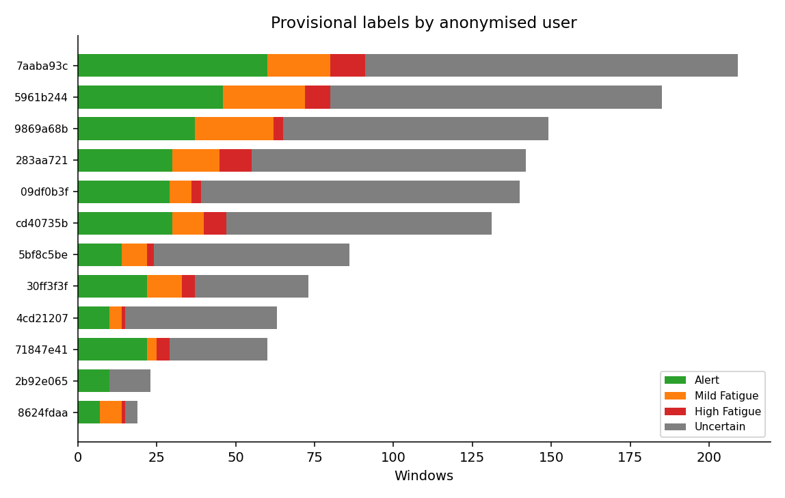
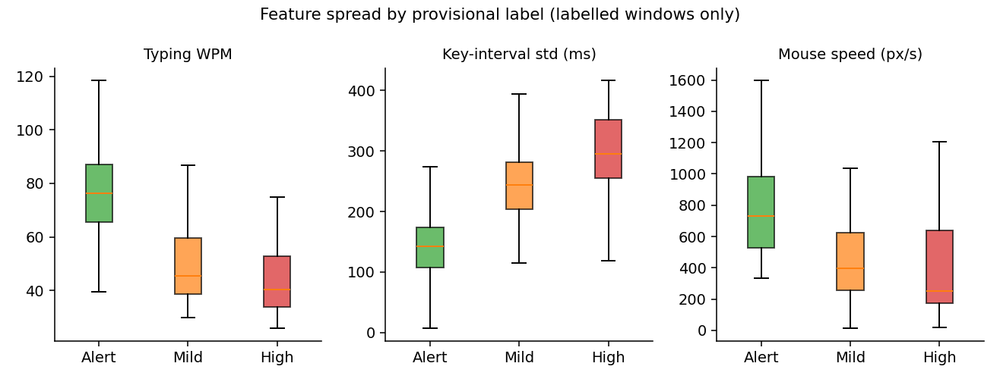

# EVTRACK provisional label evaluation

**Labels are heuristic proxies, not fatigue ground truth.** This note does not claim detection accuracy, does not retrain XGBoost, and does not change labels, fusion, or the dashboard.

Source: `data/evtrack_behaviour_labelled.csv` (`label_version=heuristic_v1`, 1280 windows, 12 users, 195 sessions). Rules compare each window to that user’s leave-one-out median on typing WPM, key-interval jitter, mouse speed, click rate, click latency, and backspace rate. Idle time and session length do not vote.

## 1. Label distribution

| Label | Windows | Share |
|---|---:|---:|
| Uncertain | 773 | 60.4% |
| Alert | 317 | 24.8% |
| Mild Fatigue | 136 | 10.6% |
| High Fatigue | 54 | 4.2% |

**Uncertain (773).** 473 windows have fewer than two measured voting channels; 300 have only a single deviation or mixed evidence. Dominant missing channels among Uncertain: click rate (667), typing WPM (583), click latency (583), key jitter (552), backspace rate (513), mouse speed (293). 513 Uncertain windows have zero keydowns; 511 have zero mousedowns; 253 lack both typing WPM and mouse speed. Median event count is 15 vs 112–156 on labelled classes. Uncertain is mostly **insufficient telemetry**, not a fourth fatigue state.

**By user** (anonymised ids). All 12 users have Alert. 11 have Mild and High; one small user (`2b92e06581f9`, 23 windows) has only Alert + Uncertain.

| User (anon prefix) | n | Alert | Mild | High | Uncertain |
|---|---:|---:|---:|---:|---:|
| 7aaba93c | 209 | 60 | 20 | 11 | 118 |
| 5961b244 | 185 | 46 | 26 | 8 | 105 |
| 9869a68b | 149 | 37 | 25 | 3 | 84 |
| 283aa721 | 142 | 30 | 15 | 10 | 87 |
| 09df0b3f | 140 | 29 | 7 | 3 | 101 |
| cd40735b | 131 | 30 | 10 | 7 | 84 |
| 5bf8c5be | 86 | 14 | 8 | 2 | 62 |
| 30ff3f3f | 73 | 22 | 11 | 4 | 36 |
| 4cd21207 | 63 | 10 | 4 | 1 | 48 |
| 71847e41 | 60 | 22 | 3 | 4 | 31 |
| 2b92e065 | 23 | 10 | 0 | 0 | 13 |
| 8624fdaa | 19 | 7 | 7 | 1 | 4 |

**By session.** 195 sessions (median 2 windows, max 86). 67 sessions are Uncertain-only. 53 sessions contain Mild; 35 contain High. 128 sessions contribute at least one Alert/Mild/High window.

## 2. Are Alert / Mild / High consistent, or user-specific?

They are **consistent in direction**, not a single-user artefact, but **volume is concentrated**.

- Top 3 users hold 54% of High (29/54) and 52% of Mild. The heaviest user holds 20% of High, not the majority.
- High is not one session: 35 sessions contribute High windows.
- Within-user, High windows sit on the fatigue side of that user’s own median: typing WPM below median in 92% (45/49), key jitter above median in 88% (42/48), mouse speed below median in 71% (36/51). Mild is similar (85% slower typing, 84% higher jitter). Alert is the opposite (27% slower typing, 26% slower mouse).
- `label_reason` for High is mostly **strong mouse slowdown** (63%), **strong key jitter** (59%), and **strong typing slowdown** (48%). Backspace almost never votes (one High window). Alert reasons are `typical_*` on the same channels.

Medians on labelled windows (Uncertain omitted from the plot):

| Feature | Alert | Mild | High |
|---|---:|---:|---:|
| typing_speed_kpm | 76.3 | 45.3 | 40.3 |
| std_key_interval_ms | 142 | 243 | 296 |
| mouse_speed_px_per_sec | 732 | 396 | 253 |
| click_rate_per_min | 62.7 | 22.5 | 22.8 |
| mean_click_latency_ms | 246 | 302 | 286 |

Idle and session minutes do **not** increase with the fatigue labels (High idle median 4.1 s vs Alert 7.4 s; session medians 2–3 min). That matches the rule that those fields never vote.

**Caveat:** a model trained on these labels is largely learning the **same heuristic** that created them (circular labels). Feature–label separation is expected by construction.

## 3. Duplicates, overlap, leakage

- No duplicate rows. No duplicate `(user, session, episode, window_start)`.
- Windows are **fixed 60 s**, non-overlapping interiors. Start-to-start gap is 60 s for 79% of adjacent pairs in an episode; the rest are 60–300 s (empty-window gaps). None are `< 60 s`.
- **Temporal leakage if you split randomly:** 371 of 507 labelled windows sit in episodes that have ≥2 labelled windows (91 episodes). Adjacent 60 s slices from the same user are highly dependent.
- **Baseline leakage is built into the labels:** leave-one-out medians still use the user’s other windows, including later ones in the same session. A user-level train/test split is required; a row-level split would leak both behaviour and the baseline.
- `mean_key_interval_ms` = `60000 / typing_speed_kpm` and `mouse_distance_px` = `mouse_speed × 60` are deterministic duplicates (not used as votes, but would leak if included as extra model features).

## 4. Missingness

| Feature | Missing windows | Notes |
|---|---:|---|
| click_rate_per_min | 1014 | Needs ≥2 clustered mousedowns |
| mean_click_latency_ms | 794 | Needs move→click ≤420 ms |
| std_key_interval_ms | 651 | Needs ≥2 burst key intervals |
| typing_speed_kpm / mean_key_interval_ms | 636 | No usable typing burst |
| backspace_rate | 595 | No keydowns in window |
| mouse_speed / mouse_distance | 378 | No clustered mousemove |
| idle_time_sec | 148 | <2 activity events |
| session_minutes | 0 | Always present; **does not vote** |

Missingness is much higher in Uncertain (~70% typing, 38% mouse) than in High (~9% typing, 6% mouse). 14 windows have WPM > 200 (key-repeat); the labeller ignores that channel rather than rewriting the stored value.

## 5. Prototype baseline suitability

**Suitable as a small heuristic-label prototype**, with strict limits:

- Keep **Alert / Mild / High only** (507 windows: 317 / 136 / 54). Treat Uncertain as excluded, not as a class to predict.
- Split **by user** (or at least by session), never by row.
- Expect the model to reconstruct `heuristic_v1`, not to estimate real fatigue.
- High Fatigue n=54 is too small for a stable 3-class generalisation claim. Class imbalance is about 6:2.5:1.
- Do not impute missing voting features with zero; complete-case or explicit missingness indicators only.
- Do not add idle/session as “fatigue” features just because they exist in the CSV.

**Not suitable** as evidence that NeuroPulse detects fatigue, for replacing Demo/Live labels, or for reporting accuracy against human drowsiness.

## 6. What this evaluation did not do

No labels were rewritten. No XGBoost retrain. No dashboard or fusion changes.
