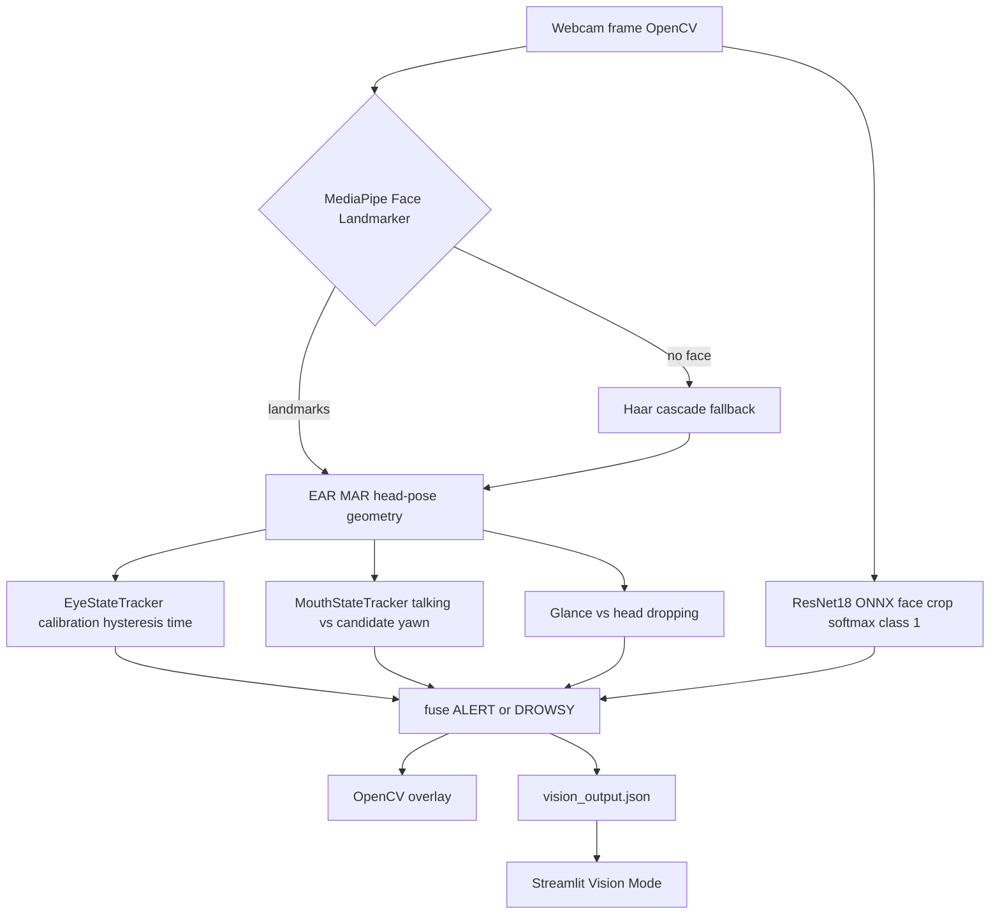

# NeuroPulse vision model

This document describes the **webcam vision pipeline as implemented in this repository**. It is written for a reader who knows basic machine learning. It is **not** a medical device description, and the displayed score is **not** a calibrated probability of fatigue.

Primary runtime entry: `python3 app.py`  
Dashboard bridge: Streamlit Vision Mode in `src/dashboard.py` reads `vision_output.json`.

---

## 1. What existed before

### Purpose

The original vision app watched a webcam, found a face, estimated how open the eyes and mouth were, ran a small image classifier on the face, and combined those signals into a **single fatigue score** (0–1, shown as a percentage). The intended use was a **demo / awareness tool** during computer work, not clinical drowsiness diagnosis.

### Components that were already in the project

These existed before the recent pipeline work (still present as files or as the older design in `backups/app.py.pre_pipeline_repair.py` and `README.md`):

| Piece | Role |
|--------|------|
| OpenCV webcam loop (`app.py`) | Capture frames, draw a box, beep on alert |
| MediaPipe face landmarks | Six-point **EAR** (eye aspect ratio) and four-point **MAR** (mouth aspect ratio) |
| Haar cascade fallback | Face/eye/mouth proxies if MediaPipe is missing |
| `fatigue_model.onnx` + `vision_model_config.json` | Whole-face **ResNet18** binary classifier |
| `train_resnet.py` / `export_resnet_onnx.py` | Train/export that face model |
| Older `train.py` / `export_model_onnx.py` / `best_model.pth` | Smaller custom CNN (64×64); **not** what `app.py` loads today |
| `capture.py` and `data/train/{drowsy,notdrowsy}` | Webcam stills for training |
| Streamlit Vision Mode | Launches `app.py` and reads `vision_output.json` |
| Behavioral dashboard (XGBoost) | Separate keyboard/mouse track; **not** part of the vision fusion |

### How the old scorer worked (backup / README)

The pre-repair live scorer (`backups/app.py.pre_pipeline_repair.py`) did **per-frame** fusion:

- `eye_score = clip((0.5 − EAR) / 0.32, 0, 1)` with a **fixed** open-eye reference of **0.5** (too high for typical webcam EAR ≈ 0.32–0.38).
- `mouth_score = clip(MAR / 0.5, 0, 1)`.
- Weighted sum with the CNN, then extra boosts if `EAR < 0.22`, `EAR < 0.18`, or **`MAR > 0.35`**.
- Short rolling average (5 frames).
- Label logic that mixed “percentage” with **DROWSY / ALERT**; comments and colors were historically inconsistent.

That design could score a normal open-eyed face as moderately fatigued, treat talking as yawning, and treat a single open-mouth frame as drowsiness.

### MediaPipe: Face Mesh vs Face Landmarker Tasks

**Current code does not import** `mediapipe.solutions.face_mesh`. Runtime uses **MediaPipe Tasks** `FaceLandmarker` with `models/mediapipe/face_landmarker.task`, `RunningMode.VIDEO`, and `detect_for_video`.

The older **Solutions Face Mesh** API (`mp.solutions.face_mesh`) was removed or never shipped in recent MediaPipe wheels used here (the project environment is Python 3.14 + MediaPipe 0.10.x). The Tasks graph is the supported way to get the same 478-point face mesh. Landmark **indices** for EAR/MAR are still the classic Face Mesh indices.

---

## 2. What was added or improved

**Already existed (kept, then wired into a modular package):** webcam loop, OpenCV, MediaPipe landmarks, EAR/MAR geometry, Haar fallback, ResNet18 ONNX face classifier, JSON bridge, dashboard launch.

**Implemented in the current `vision/` package (recent work):**

1. **Calibrated eye state** (`vision/eye_state.py`): a short open-eye baseline (45 frames, saved to `data/eye_calibration.json`), plus **hysteresis** so EAR does not flicker between open and closed.
2. **Temporal eye logic**: blink vs prolonged vs sustained closure using **time in seconds**, not a single frame.
3. **Two primary fatigue labels only:** `ALERT` and `DROWSY` (`vision/fusion.py`). There is no live `POSSIBLE FATIGUE` state (older README text is stale).
4. **Head pose as activity, not a drowsy trigger**: pitch from the facial transform matrix **or** a landmark “looking down” ratio; timed as glance vs head dropping. Fusion **does not** set `DROWSY` from head pose alone.
5. **Mouth timing**: MAR over time; short openings → talking; wide opening held ≥ **1.20 s** → candidate yawn. No `MAR > 0.35` instant boost. There is **no** trained yawn video model (`YawnClassifierInterface` is a stub).
6. **PERCLOS recovery**: the 30 s closed-eye fraction can support `DROWSY` **only while eyes are currently CLOSED** and the user is not in a brief glance. Reopening the eyes returns the primary label to `ALERT` even if PERCLOS is still high.
7. **`label` vs `activity_label`**: JSON `label` is only `ALERT` or `DROWSY`. Overlay/dashboard may also show `Talking`, `Glancing down`, `Drowsy-possible yawn`, etc.
8. **Face CNN is confirmation-only**: it can add a small index when landmark evidence is already elevated; it **cannot** create `DROWSY` by itself.
9. **ONNX failures return `None`**, not a silent 0.

---

## 3. Every model

### A. MediaPipe Face Landmarker (active)

| | |
|--|--|
| **Name** | MediaPipe Face Landmarker (Tasks) |
| **File** | `models/mediapipe/face_landmarker.task` |
| **Task** | Detect one face and 478 mesh landmarks (and a 4×4 pose matrix) |
| **Input** | RGB frame, `RunningMode.VIDEO`, monotonic timestamps |
| **Output** | Normalized landmarks (`x,y` in 0–1); optional transformation matrix |
| **Runtime** | MediaPipe / TFLite inside the Tasks API |
| **Status** | **Required** for the accurate EAR/MAR path |

If this file or import fails, the detector falls back to OpenCV Haar cascades (coarser EAR/MAR proxies).

### B. Whole-face ResNet18 ONNX (active)

| | |
|--|--|
| **Name** | `fatigue_model.onnx` (weights often in `fatigue_model.onnx.data`) |
| **Architecture** | torchvision **ResNet18**, classifier `Dropout(0.35) → Linear(512, 2)` |
| **Task** | Image classification: **notdrowsy (0)** vs **drowsy (1)** on a **face crop** (default) or full frame |
| **Input** | `image`, float32 NCHW, **1×3×160×160**, ImageNet mean/std `(0.485, 0.456, 0.406)` / `(0.229, 0.224, 0.225)` — from `vision_model_config.json` |
| **Output** | 2 **logits** (not softmax in the graph). App applies softmax; **P(drowsy) = softmax[1]** |
| **Runtime** | ONNX Runtime, `CPUExecutionProvider` |
| **Path** | project root `fatigue_model.onnx` (override `FATIGUE_ONNX_PATH`) |
| **Status** | **Loaded at runtime**, but fusion uses it only as a **weak confirmation** |

Default region: expand the face box ×1.22, crop, RGB, optional horizontal-flip TTA (`FATIGUE_ONNX_TTA`, default on).

Grouped-split **offline** numbers for `best_model_resnet.pth` (same family as this ONNX; **not** a webcam trial) are in `eval_grouped_resnet.json`: val accuracy **0.908**, test **0.897**, alert-class false-positive rate **0.0** on that still-image split. An older leaky split reported val **0.868** in `eval_resnet_train_end.json`. **Do not treat these as live camera accuracy.**

PyTorch source weights: `best_model_resnet.pth`. Export script: `export_resnet_onnx.py`.

### C. Older custom CNN (unused by `app.py`)

| | |
|--|--|
| **Files** | `best_model.pth`, `train.py`, `export_model_onnx.py` |
| **Architecture** | Small conv net, **64×64**, Normalize 0.5/0.5 |
| **Status** | **Not loaded** by the current detector. `vision_model_config.json` says ResNet18 / 160. Keep as a historical training path. |

README still describes this 64×64 CNN as “the” runtime model; **that is outdated**.

### D. Historical note (not in the live app)

An experimental **96×96 open/closed eye-crop** classifier was trained offline (`train_vision_models.py --eyes-root`, checkpoints under `models/vision/*eyes*`). It was **never** part of the approved baseline and is **not loaded** at runtime. There is no environment flag or dashboard control to enable it.

### E. No dedicated yawn / speech network

Mouth class uses **MAR duration only**. `YawnClassifierInterface.predict` always returns “not available”.

### F. Behavioral XGBoost (not vision)

`models/behavior_xgb.pkl` is the Streamlit **Neural Dashboard** model (typing/mouse). It does not feed vision fusion.

---

## 4. Processing flow

**Terms (plain language)**

- **EAR (eye aspect ratio):** how open an eye is (vertical opening ÷ width). Smaller ≈ more closed.
- **MAR (mouth aspect ratio):** inner-lip opening ÷ mouth width. Larger ≈ more open.
- **PERCLOS:** fraction of time the eyes were classified CLOSED in the last **30 s** (unknown frames ignored).
- **Hysteresis:** different EAR cutoffs for “become closed” vs “become open,” to reduce flicker.
- **Fusion:** combining timed landmark cues (and optionally the CNN) into `ALERT` / `DROWSY`.
- **Index:** a 0–1 heuristic shown on screen; **not** a calibrated probability.



**Step by step**

1. **Capture** — `cv2.VideoCapture(0)` in `app.py`.
2. **Landmarks** — BGR→RGB MediaPipe `Image`; `detect_for_video`.
3. **Measurements** — left/right EAR (indices 362… and 33…), MAR (13, 14, 78, 308), bbox from face oval, looking-down from **pitch ≤ −12° or landmark ratio ≥ 0.42**.
4. **Temporal trackers** — eye calibration + blink/closure timers; mouth open duration; how long the head has been down (`head_drop_min_s` = **1.20 s** for “head dropping”, otherwise “glance”).
5. **CNN** — face crop → 160×160 → logits → softmax → P(drowsy). Failures are `None`.
6. **Fusion** — see section 5. Primary `label`; separate `activity_label`.
7. **Output** — overlay (`vision/overlay.py`); JSON (`label`, `activity_label`, `fatigue_score`, reasons, …); optional macOS beep if `label == DROWSY` with **4.0 s** cooldown. **Q** quits, **C** recalibrates. FaceLandmarker and camera are closed in `finally`.

OpenCV also draws the box and text. Hershey fonts cannot draw `·`, so the overlay uses ASCII `-` (`ALERT - Talking`).

---

## 5. Decision logic (from `vision/config.py` and `vision/fusion.py`)

Defaults below are the **code defaults**. Optional `vision_runtime_config.json` can override them if present.

### Eye calibration and classification

- Collect **45** open-eye EAR samples (not looking down; samples below `0.85 × 0.34` ignored). Median clipped to [0.22, 0.48].
- Closed if EAR **&lt; baseline × 0.62**; open if EAR **&gt; baseline × 0.80**; between those, keep the previous state.
- Missing landmarks → **UNKNOWN**, not closed.
- Uncalibrated default open EAR = **0.34**.

### Primary label (`ALERT` / `DROWSY`)

`DROWSY` only if **either**:

1. Eyes are **CLOSED** for at least **`drowsy_closure_s` = 1.50 s**, and the head is **not** in a brief glance; **or**
2. Eyes are **currently CLOSED**, not glancing, and **PERCLOS ≥ 0.40** over 30 s.

Otherwise **`ALERT`**.

During a **brief glance**, the closed-eye duration limit used for “sustained” is **`drowsy_closure_looking_down_s` = 2.50 s**, and glance frames **cannot** set `DROWSY` via the `not is_glance` guards. Head dropping uses the normal **1.50 s** eye rule, but **head dropping without closed eyes stays ALERT**.

| Situation | Primary label |
|-----------|----------------|
| Normal blink (closed ≤ **0.45 s**) | ALERT |
| Short closure (e.g. ~1 s; below 1.50 s) | ALERT |
| Closed ≥ **1.50 s** (not a brief glance) | DROWSY |
| Eyes open again | ALERT (PERCLOS does not keep DROWSY) |
| Talking (short MAR in speech band) | ALERT; activity `Talking` |
| Wide mouth ≥ **1.20 s** at MAR ≥ **0.48** | ALERT unless eyes also meet DROWSY; activity `Drowsy-possible yawn` |
| Glance / head dropping, eyes open | ALERT; activity `Glancing down` / `Head dropping` |
| Face CNN high, eyes open | ALERT (model ignored while landmarks are alert) |
| No face / unknown eyes | ALERT; activity `No face` or `Uncertain tracking` |

`prolonged_closure_s` = **0.80 s** is used for events/reasons and a higher **index** while still closed; it does **not** by itself set `DROWSY`.

Yawn may add **0.18** to the internal index; the ALERT branch then **caps the displayed index at 0.25**. CNN confirmation adds at most **0.12** and only if the index is already ≥ **0.40**.

Beep: `status == "DROWSY"` and **4.0 s** since last beep.

---

## 6. Testing and limitations

### Unit tests

```bash
python3 -m unittest discover -s tests -v
```

Coverage (synthetic, not camera accuracy): EAR/MAR; invalid landmarks; hysteresis; blink vs sustained closure; calibration; speech vs candidate yawn; missing face; ONNX failure → `None`; class index 1 = drowsy; grouped splits without aug leakage; overlay headline without `?`; glance activity vs ALERT.

**Result obtained while writing this document (after cleanup):** `python3 -m unittest discover -s tests -v`.

### Live webcam (informal)

User-reported baseline: blinks / talking / ~1 s closure → ALERT; ~2 s closure → DROWSY; reopen → ALERT. That is a **manual check**, not a labeled benchmark.

### What this system is not

- Not a medical or occupational drowsiness meter.
- The overlay **index is not a probability**.
- MAR cannot reliably separate speech from a yawn.
- Face ResNet still-image accuracy ≠ webcam temporal accuracy.

---

## How to run

```bash
python3 app.py
```

Optional dashboard: `cd src && streamlit run dashboard.py` → Vision Mode.

Retrain face ResNet (does not change live thresholds): `python3 train_resnet.py` then `python3 export_resnet_onnx.py`. Keep `vision_model_config.json` next to the ONNX file.
